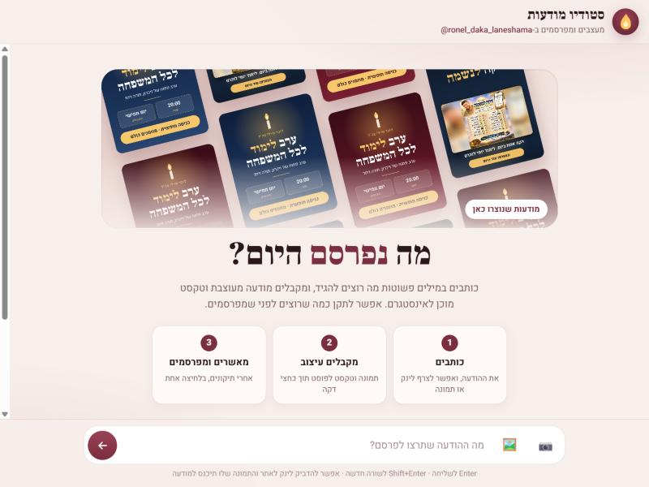
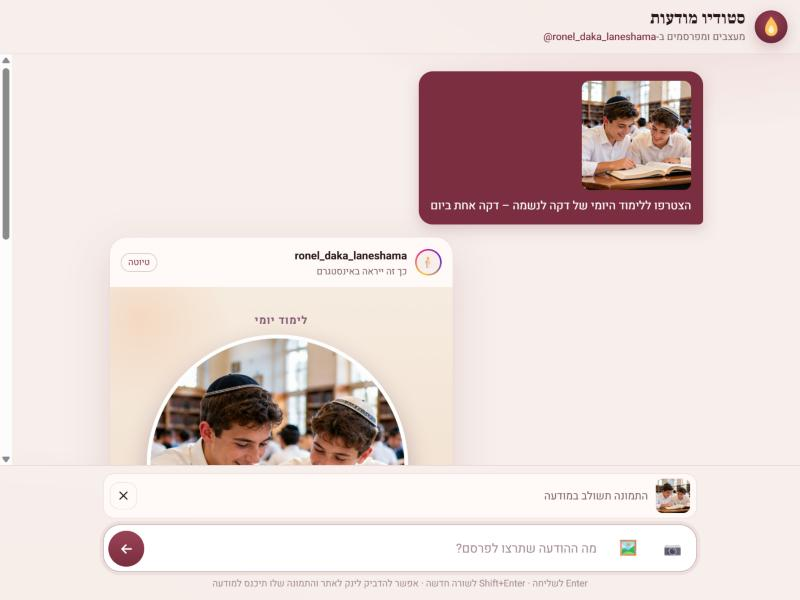
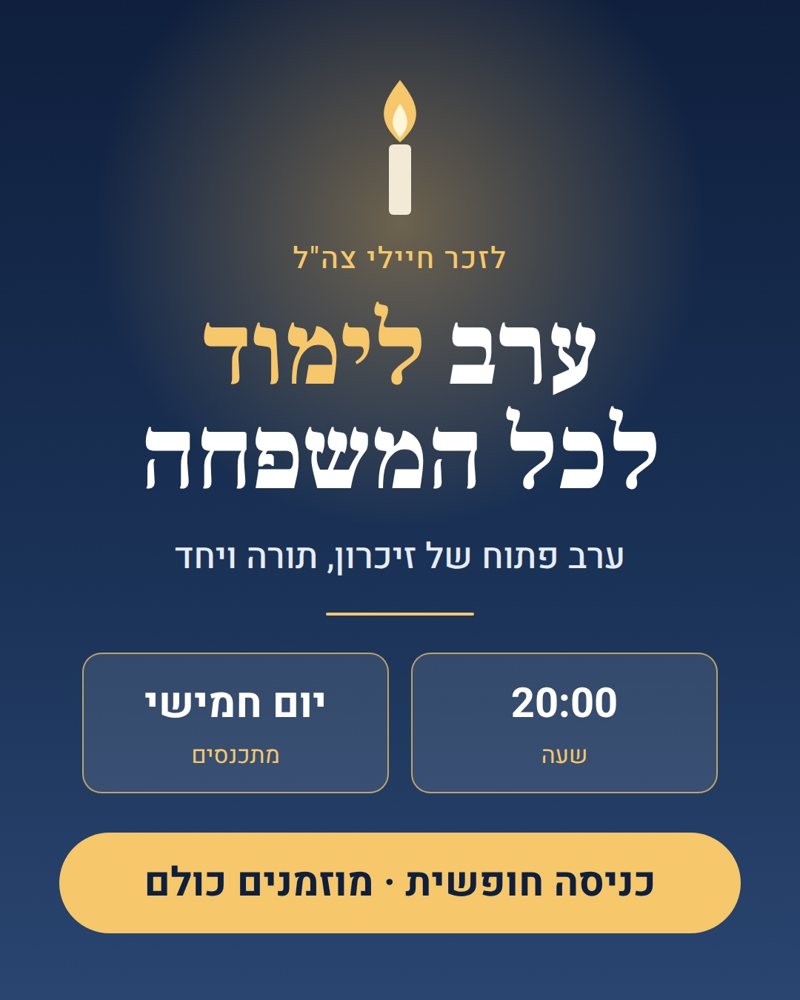
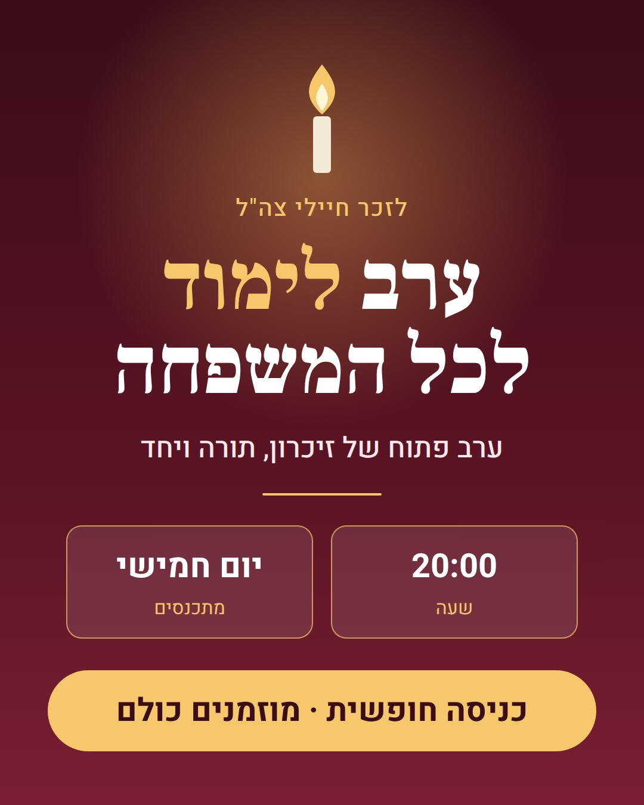
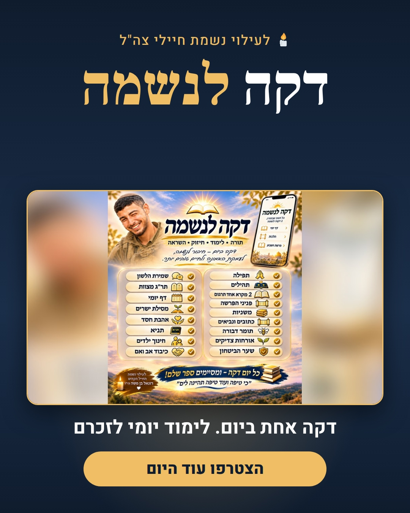

# סטודיו מודעות: צ'אט שמעצב ומפרסם לאינסטגרם, על Make

גרסה של הרעיון של הריפו הזה, שרצה כולה בתוך Make, בלי שרת ובלי מפתחות API משלך.
כותבים הודעה, מקבלים מודעה מעוצבת וטקסט לפוסט, מתקנים, ומפרסמים לאינסטגרם בלחיצה.

```
דפדפן ──GET──▶ Webhook ב-Make ──▶ מחזיר את דף הצ'אט (chat-page.html)
דפדפן ──POST──▶ אותו Webhook, לפי action:
   preview   → Claude כותב טקסט לפוסט + HTML של המודעה → hcti.io הופך ל-JPG → חוזר לצ'אט
   publish   → Instagram: Create a photo post
   linkimage → קורא דף מהקישור ומחזיר את og:image שלו
   gallery   → Instagram: List posts → רשימת תמונות לגלריה
```

## דוגמאות

<p>


</p>

מודעות אמיתיות שהצ'אט יצר (כל אחת תוך 10–15 שניות):

| הבקשה | התוצאה |
|---|---|
| "ערב לימוד פתוח לכל המשפחה לזכר חיילי צה"ל, יום חמישי 20:00, כניסה חופשית" |  |
| ✏️ תיקון עיצוב בלבד: "רקע בורדו חם במקום כחול". רק הרקע השתנה, הטקסט נשאר מילה במילה |  |
| הודעה עם לינק לאתר. התמונה הראשית של הדף נכנסה למודעה |  |
| תמונה שנבחרה מהגלריה (🖼️) מהאתר |  |

## מה יש בצ'אט

- **עיצוב מודעה** בגודל 1080×1350, בכל פעם בסגנון אחר שמתאים להודעה.
- **✏️ תיקון** עם בחירה: עיצוב התמונה, טקסט הפוסט, או שניהם. תיקון טקסט בלבד לא מייצר תמונה חדשה.
- **תמונות:** 📷 מהמכשיר, 🖼️ גלריה מהאתר ומהפוסטים באינסטגרם, או לינק לדף באתר (נלקחת התמונה הראשית שלו).
  Claude לא רואה את התמונה: הוא כותב `` ו-Make מחליף את זה בתמונה האמיתית רגע לפני הצילום.
- **תצוגה כמו פוסט באינסטגרם**, עריכת הטקסט ישירות, ואישור כפול לפני פרסום.
- **קוד גישה:** כל פעולה מלבד פתיחת הדף דורשת קוד, שנבדק במסננים של ה-Router.

## הקבצים

| קובץ | מה זה |
|---|---|
| `chat-page.html` | דף הצ'אט. נשמר בתוך מודול ה-Webhook response של Make ומוגש משם |
| `make-blueprint.json` | התרחיש המלא, לייבוא ל-Make |
| `designer-prompt.txt` | ההוראות ל-Claude: איך לעצב ומה לכתוב |

## הקמה

1. ב-Make: **Create a new scenario → Import blueprint** ובוחרים את `make-blueprint.json`.
2. בכל מודול שמסומן באדום בוחרים את החיבור שלך: Webhook חדש, Anthropic Claude, Basic Auth ל-hcti.io, Facebook/Instagram.
3. במודולים של אינסטגרם בוחרים את החשבון במקום `YOUR_INSTAGRAM_ACCOUNT_ID`.
4. מחליפים את `YOUR_ACCESS_CODE` בכל המסננים בקוד גישה ארוך ואקראי משלך.
5. מפעילים את התרחיש ופותחים את כתובת ה-Webhook בדפדפן. זה הצ'אט.

**שימו לב:** בתוכנית החינמית של Make אפשר רק 2 תרחישים פעילים. hcti.io בחינם עד כ-50 תמונות בחודש.
דף הצ'אט מכיל כרגע את שם החשבון והתמונות של "דקה לנשמה", ואפשר להחליף אותם בקלות בראש הקובץ.

## עדכון הדף

הדף נשמר כטקסט בתוך התרחיש, אז אחרי שינוי ב-`chat-page.html` צריך להדביק אותו מחדש לשדה ה-Body של מודול "דף הצ'אט".
אסור שיופיע בו `{{` כי Make מפרש את זה כנוסחה.
